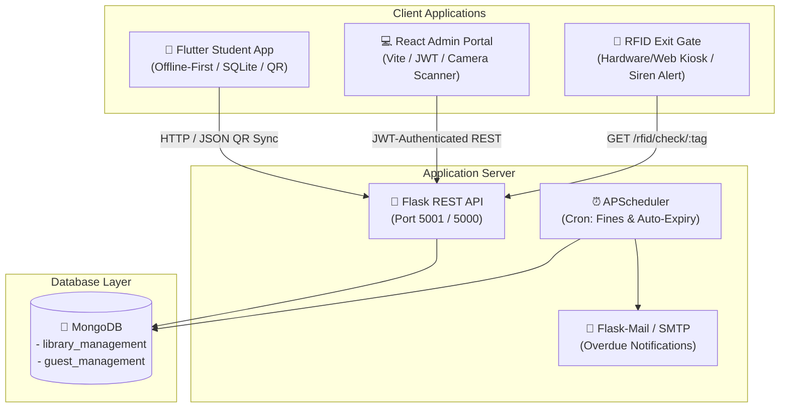

# 📚 Offline-First Smart Library Management System

[](https://python.org)
[](https://flask.palletsprojects.com/)
[](https://react.dev/)
[](https://vitejs.dev/)
[](https://flutter.dev/)
[](https://www.mongodb.com/)
[](LICENSE)

An end-to-end, IoT-integrated, offline-capable smart library management ecosystem designed to streamline institutional book circulation, attendance monitoring, and inventory security. Built with a **Flask API backend**, a **React/Vite admin dashboard**, a cross-platform **Flutter student mobile app**, and an **RFID physical gate security system**.

---

## 📑 Table of Contents

- [System Architecture](#-system-architecture)
- [Key Features](#-key-features)
- [Project Structure](#-project-structure)
- [Tech Stack](#-tech-stack)
- [Getting Started](#-getting-started)
  - [Prerequisites](#prerequisites)
  - [1. Backend Setup](#1-backend-setup)
  - [2. Admin Web Portal](#2-admin-web-portal)
  - [3. Flutter Student App](#3-flutter-student-app)
  - [4. RFID Gate Security System](#4-rfid-gate-security-system)
- [QR Code Protocol](#-qr-code-protocol)
- [API Reference](#-api-reference)
- [Automated Scheduled Tasks](#-automated-scheduled-tasks)
- [Deployment](#-deployment)
- [Contributing & License](#-contributing--license)

---

## 🏛 System Architecture



---

## ✨ Key Features

### 1. 📱 Student Mobile Application (Flutter)
- **Offline-First Architecture**: Caches book catalogs and user history locally with `sqflite` for low-connectivity environments.
- **Dynamic QR Code Generation**: Generates cryptographically verifiable QR payloads for:
  - Library gate attendance check-in/out
  - Self-service book borrowing cart
  - Immediate book returns
- **Book Discovery**: Category-based search, detailed synopsis, ratings, and peer reviews.
- **Circulation & Due-Date Tracking**: Instant alerts on active rentals, overdue status, and accrued fines.
- **Wishlist & Cart**: Queue up to 3 books simultaneously before approaching circulation desks.

### 2. 💻 Admin Web Portal (React + Vite)
- **Live Operations Dashboard**: Metric cards tracking active rentals, overdue returns, pending reservations, and daily headcount.
- **Full-Screen Smart Scanner**: Integrated camera barcode/QR scanner handling multi-purpose tasks seamlessly.
- **Inventory Control**: Add, update, paginate, and track physical shelf coordinates (Section, Row, Shelf) with image upload support.
- **Fines & Waiver Management**: Automated calculation of overdue fees with manual waiver authorization.
- **One-Click Broadcast Alerts**: Trigger automated email notifications to all defaulting borrowers.

### 3. 🚧 RFID Gate Exit Security
- **Anti-Theft Real-Time Interceptor**: Validates physical 4-digit RFID tags against active rental records at library exits.
- **Dual Visual & Audio Alarms**: Red strobe screen overlay and audible warning tone on unrented book removals.
- **Audit Logs**: Maintains rolling in-browser exit attempts with timestamped event histories.

### 4. ⚙️ Central API & Automation Engine (Flask)
- Secure token-based access with **JWT authentication** and role protection.
- Dual database isolation supporting standard student operations and guest access.
- Background **APScheduler daemon**:
  - Automatically expires uncollected reservations hourly.
  - Computes late fees daily and dispatches automated reminder emails.

---

## 📁 Project Structure

```
offline-first-library-management-system/
├── admin-portal/              # React 19 + Vite Administrative Dashboard
│   ├── src/
│   │   ├── components/        # Reusable UI (Layout, Navbar, ProtectedRoute)
│   │   ├── pages/             # Dashboard, Books, Scanner, Fines, Reservations
│   │   ├── services/          # Axios instance with JWT interceptors
│   │   └── styles/            # Theming and global stylesheet
│   ├── package.json
│   └── vite.config.js
│
├── backend/                   # Flask REST API Engine
│   ├── models/                # MongoDB schema definitions & query helpers
│   ├── routes/                # Blueprint endpoints (auth, admin, scanner, rfid, user)
│   ├── utils/                 # JWT, QR parsing, fine calculator, scheduler, mailer
│   ├── app.py                 # Application bootstrap & route registration
│   ├── config.py              # Environment configuration loader
│   ├── requirements.txt       # Python package dependencies
│   └── .env.example           # Environment template
│
├── Student-app/               # Flutter Multi-Platform Mobile Application
│   ├── lib/
│   │   ├── models/            # Dart data models
│   │   ├── providers/         # State management (ChangeNotifier providers)
│   │   ├── screens/           # Auth, Home, BookDetails, Cart, Scanner, Reservations
│   │   ├── services/          # Network client, offline SQLite storage
│   │   └── theme/             # Light & Dark theme definitions
│   └── pubspec.yaml           # Flutter dependencies and assets
│
├── rf-gate/                   # Hardware/Web RFID Exit Gate Interceptor
│   ├── index.html             # Single-page exit verification kiosk
│   ├── alarm.mp3              # Siren audio asset
│   └── README.md
│
├── .gitignore                 # Clean repository exclusion rules
└── README.md                  # Project documentation
```

---

## 🛠 Tech Stack

| Domain | Technology | Purpose |
|---|---|---|
| **Backend Framework** | Flask 3.0.0 (Python) | Core RESTful API service |
| **Database** | MongoDB (PyMongo) | Flexible document store for inventory & logs |
| **Authentication** | PyJWT, Werkzeug | Stateless HMAC-SHA256 bearer tokens |
| **Scheduler** | APScheduler | Background cron tasks for fines & expiries |
| **Admin Frontend** | React 19, Vite, Axios | High-performance administrative SPA |
| **Styling** | Vanilla CSS3 + Lucide Icons | Responsive glassmorphic interface |
| **Mobile App** | Flutter 3.x, Dart 3.x | Cross-platform student mobile client |
| **Local Storage** | SQLite (`sqflite`), Provider | Offline-first sync & reactive state |
| **Security Gate** | HTML5, JavaScript ES6 | Edge terminal for physical RFID validation |

---

## 🚀 Getting Started

### Prerequisites

Ensure the following runtimes are installed on your workstation:
- **Python**: `3.10+` and `pip`
- **Node.js**: `18.x+` and `npm`
- **Flutter SDK**: `3.10+` (with Android Studio / Xcode configured)
- **MongoDB**: Local Community Server (`localhost:27017`) or a free [MongoDB Atlas Cluster](https://cloud.mongodb.com)

---

### 1. Backend Setup

1. **Navigate to the backend directory:**
   ```bash
   cd backend
   ```

2. **Create and activate a virtual environment:**
   ```bash
   # Windows (PowerShell)
   python -m venv .venv
   .\.venv\Scripts\Activate.ps1

   # Linux / macOS
   python3 -m venv .venv
   source .venv/bin/activate
   ```

3. **Install dependencies:**
   ```bash
   pip install -r requirements.txt
   ```

4. **Configure environment variables:**
   ```bash
   cp .env.example .env
   ```
   *Edit `.env` with your MongoDB URI, JWT secret, and email credentials:*
   ```env
   MONGO_URI=mongodb://localhost:27017/
   DB_NAME=library_management
   GUEST_DB_NAME=guest_management
   JWT_SECRET_KEY=super-secure-production-key-here
   HOST=0.0.0.0
   PORT=5001
   DEBUG=False
   CORS_ORIGINS=*
   FINE_PER_DAY=5.0
   MAX_BOOKS_PER_RENTAL=3
   RENTAL_DURATION_DAYS=14
   RESERVATION_EXPIRY_HOURS=1
   ```

5. **Initialize an Admin Account:**
   Execute a quick Python script to insert an admin credential:
   ```python
   from pymongo import MongoClient
   from werkzeug.security import generate_password_hash
   from datetime import datetime

   client = MongoClient('mongodb://localhost:27017/')
   db = client['library_management']

   db.admin_login.insert_one({
       "email": "admin@example.com",
       "password_hash": generate_password_hash("admin123"),
       "name": "Super Admin",
       "role": "admin",
       "created_at": datetime.utcnow(),
       "is_active": True
   })
   print("Admin account seeded successfully!")
   ```

6. **Start the API Server:**
   ```bash
   python app.py
   ```
   The backend will be available at `http://localhost:5001` (Health endpoint: `http://localhost:5001/health`).

---

### 2. Admin Web Portal

1. **Navigate to the portal directory:**
   ```bash
   cd admin-portal
   ```

2. **Install node dependencies:**
   ```bash
   npm install
   ```

3. **Configure API base URL:**
   Create an `.env` file (or rely on the default fallback):
   ```env
   VITE_API_URL=http://localhost:5001
   ```

4. **Run development server:**
   ```bash
   npm run dev
   ```
   Access the dashboard at `http://localhost:5173` and log in with `admin@example.com` / `admin123`.

---

### 3. Flutter Student App

1. **Navigate to the mobile directory:**
   ```bash
   cd Student-app
   ```

2. **Fetch packages:**
   ```bash
   flutter pub get
   ```

3. **Configure API Target:**
   Ensure `lib/services/api_service.dart` (or your configuration file) points to your machine's LAN IP address or production URL (e.g. `http://192.168.1.X:5001` when running on a physical Android device).

4. **Launch the application:**
   ```bash
   # Run in connected emulator or device
   flutter run

   # Or compile a release APK
   flutter build apk --release
   ```

---

### 4. RFID Gate Security System

1. **Navigate to the RFID terminal folder:**
   ```bash
   cd rf-gate
   ```

2. **Run locally:**
   Double-click `index.html` to open in any web browser, or serve it using any lightweight static server:
   ```bash
   npx serve .
   ```
3. Enter any 4-digit RFID tag configured on a book copy. The kiosk evaluates exit clearance and triggers sirens if the copy has not been checked out.

---

## 📲 QR Code Protocol

The system utilizes structured JSON payloads encoded within standard 2D QR codes:

| Purpose | Sample Payload | System Behavior |
|---|---|---|
| **Attendance** | `{"purpose": "ATTENDANCE", "user_id": "<ID>"}` | Toggles user status between *Inside* and *Outside*. |
| **Checkout / Renting** | `{"purpose": "RENTING", "user_id": "<ID>", "book_ids": ["<B1>", "<B2>"]}` | Allocates inventory copies, validates 3-book limit, stamps due dates. |
| **Return** | `{"purpose": "RETURNING", "user_id": "<ID>", "book_ids": ["<B1>"]}` | Relinquishes allocation, computes pending fines, updates history. |
| **Transaction Lookup** | `{"purpose": "TRANSACTION", "transaction_id": "<TX_ID>"}` | Pulls receipt, item breakdown, and settlement details. |

---

## 📡 API Reference

### Authentication
- `POST /auth/admin/login` — Authenticate admin & issue JWT
- `GET /auth/admin/validate` — Verify active token validity

### Inventory & Management (Protected)
- `GET /admin/dashboard/stats` — Aggregate metrics for books, rentals, overdue, attendance
- `GET /admin/books` — Paginated list of cataloged titles
- `POST /admin/books/add` — Register a new book with copy metadata
- `POST /admin/books/upload_image/<book_id>` — Upload cover picture
- `GET /admin/reservations` — List active reservations awaiting pickup
- `DELETE /admin/reservations/cancel/<id>` — Revoke reservation
- `GET /admin/overdue` — List all overdue rentals with calculated charges
- `POST /admin/notify/overdue` — Trigger batch email reminders

### Scanner & Security
- `POST /admin/scanner/scan_qr` — Process multi-purpose operational QR payloads
- `GET /rfid/check/<rfid>` — Instant gate check for physical book RFID tags

---

## ⏰ Automated Scheduled Tasks

The backend utilizes `APScheduler` to run autonomous cron jobs:
- **Hourly Expiry Worker**: Scans reservations with `status == "ACTIVE"`. If elapsed time exceeds `RESERVATION_EXPIRY_HOURS`, the reservation is automatically flagged as expired and the book copy is released back into circulation.
- **Daily 9:00 AM Fine & Notification Worker**: Computes accruals according to `FINE_PER_DAY` and dispatches automated warning emails via SMTP to all delinquent accounts.

---

## 🚢 Deployment

For complete end-to-end cloud hosting instructions:
- **Backend**: Free deployment on [Render](https://render.com) or Railway
- **Admin Portal**: Instant edge hosting on [Vercel](https://vercel.com) or Netlify
- **Database**: Cloud clustering on [MongoDB Atlas](https://cloud.mongodb.com)
- **Exit Gate**: Host for free via [GitHub Pages](https://pages.github.com)

👉 Refer to the detailed step-by-step [Deployment Guide](deployment-guide.md) included in this repository.

---

## 📄 License

This project is licensed under the MIT License — see the [LICENSE](LICENSE) file for details.

